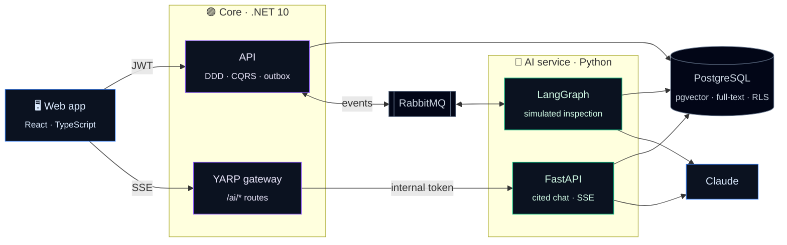

<!-- ============================================================ -->
<!--                         HEADER                                -->
<!-- ============================================================ -->

  

  <i>Building regulated, high-availability systems for the Brazilian public health sector. Shipping the reusable pieces to NuGet.</i>

  
  &nbsp;
  
  &nbsp;
  
  &nbsp;
  
  &nbsp;
  

 

---

## About

I have three years of production experience with .NET. At work I design modular monoliths for state-government health-surveillance workflows, where the domain has to be correct, traceable, and auditable.

Outside of work I maintain [Lumen](https://github.com/KauaVilasBoas/Lumen), a family of authorization and identity libraries for ASP.NET Core published on NuGet. Each package is versioned on its own, its decisions are recorded in ADRs, and a multi-tenant system for a pharmacology lab runs it in production. Every generic API in it started as a requirement from that system.

I default to Clean Architecture, Domain-Driven Design, and CQRS where they earn their place, and a change is done when its unit and integration tests are.

Open to remote backend roles in EU, UK, or US Eastern time zones.

---

## Core expertise

<table align="center">
  <tr>
    <td align="center" valign="top" width="240">
      <b>Core</b>
        
      
      &nbsp;&nbsp;
      
        
      C# · .NET 8 · ASP.NET Core · EF Core · Dapper
    </td>
    <td align="center" valign="top" width="240">
      <b>Data</b>
        
      
      &nbsp;&nbsp;
      
      &nbsp;&nbsp;
      
        
      SQL Server · PostgreSQL · MongoDB · Redis
    </td>
    <td align="center" valign="top" width="240">
      <b>Infra</b>
        
      
      &nbsp;&nbsp;
      
      &nbsp;&nbsp;
      
        
      Docker · Terraform · AWS · Jenkins · GitHub Actions
    </td>
  </tr>
</table>

  <b>Practices</b> &nbsp;·&nbsp; Clean Architecture &nbsp;·&nbsp; DDD &nbsp;·&nbsp; CQRS &nbsp;·&nbsp; Outbox &nbsp;·&nbsp; SOLID &nbsp;·&nbsp; xUnit &nbsp;·&nbsp; Testcontainers &nbsp;·&nbsp; architecture testing
   
  <b>Currently exploring</b> &nbsp;·&nbsp; distributed systems &nbsp;·&nbsp; system design at scale &nbsp;·&nbsp; observability patterns

---

## Engineering principles

> *Architecture is the set of constraints I impose now to make change easier later.*

- **Dependency direction matters more than folder structure.** The layers follow from one rule: the Domain depends on nothing.
- **If a boundary isn't tested, it doesn't exist.** NetArchTest and ArchUnit suites check module isolation and dependency rules, and they fail the build when one breaks. A rule written only in the docs drifts without anyone noticing.
- **A library earns its abstractions from a real consumer.** Every extension point in Lumen exists because a shipping system needed it, and an ADR records why.
- **A modular monolith ships faster than a half-baked microservice.** Splitting a service out adds network calls, deployments, and failure modes, so I do it only when a requirement asks for it.

---

## Currently building

### [Normetry](https://github.com/KauaVilasBoas/Normetry) &nbsp;·&nbsp; Multi-tenant compliance copilot for regulated establishments

  
  &nbsp;
  
  &nbsp;
  
  &nbsp;
  
  &nbsp;
  
  &nbsp;
  

> A restaurant manager has to follow a food-safety code that runs to hundreds of pages, and the evidence sits in a binder of SOPs, licenses, and temperature logs that nobody re-reads. Normetry reads the establishment's documents against the regulation. Every claim it makes cites an article and, when the claim is about the establishment, the passage of its document that backs the claim.
>
> **Three jurisdictions (FDA Food Code, EU 852/2004, Anvisa RDC 216/2004), questions in Portuguese or English, 131 inspection checklist items.** I build it in public, one phase at a time. The cited regulation chat and the simulated inspection work today, and the regulation change monitor comes next.

### How it's built

- A .NET 10 core (DDD, CQRS, EF Core, outbox, YARP, SignalR) owns the business logic and is the only public entry point. A Python service (FastAPI, LangGraph) owns the AI, and only the gateway can reach it.
- Retrieval is written by hand: pgvector and PostgreSQL full-text search, fused with Reciprocal Rank Fusion, then a multilingual re-ranker. The model answers in structured JSON, and a deterministic guard drops any claim whose quote isn't in a retrieved chunk.
- PostgreSQL Row-Level Security covers every tenant-owned table. The tenant comes from the validated JWT and is set per transaction, so even a buggy query can't return another tenant's rows.
- Every pull request that touches retrieval, ingestion, or the datasets runs the retrieval eval, and CI fails when recall or MRR drops below its floor.

Only .NET writes the `core` schema and only Python writes the `ai` schema. AI results such as findings and document status reach the core as queue events.

  The repository covers the architecture, the ADRs behind each decision, the eval reports, and how to run it locally:
    
  

---

## Dashboard

  
  &nbsp;
  

  

  

---

## Connect

  
  &nbsp;
  
  &nbsp;
  
  &nbsp;
  

  

