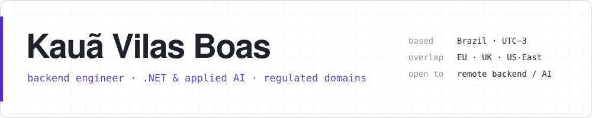
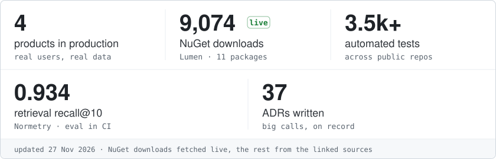
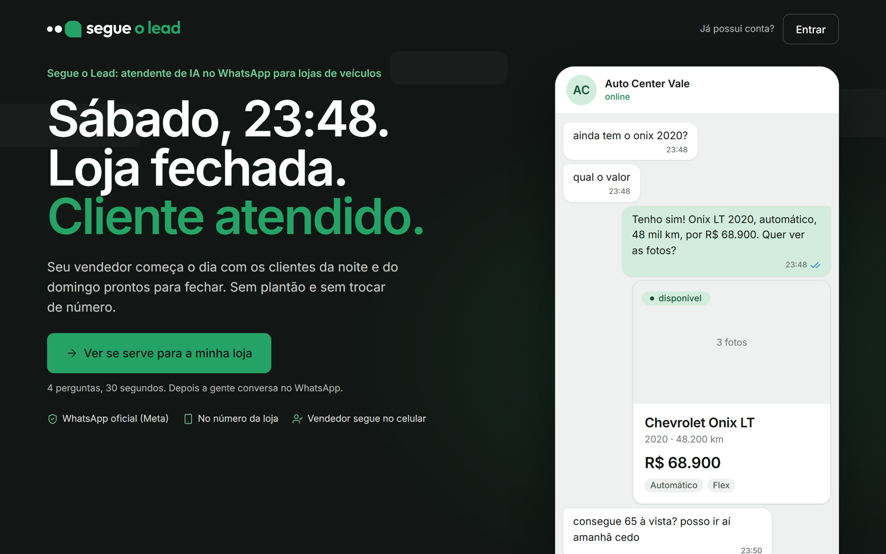
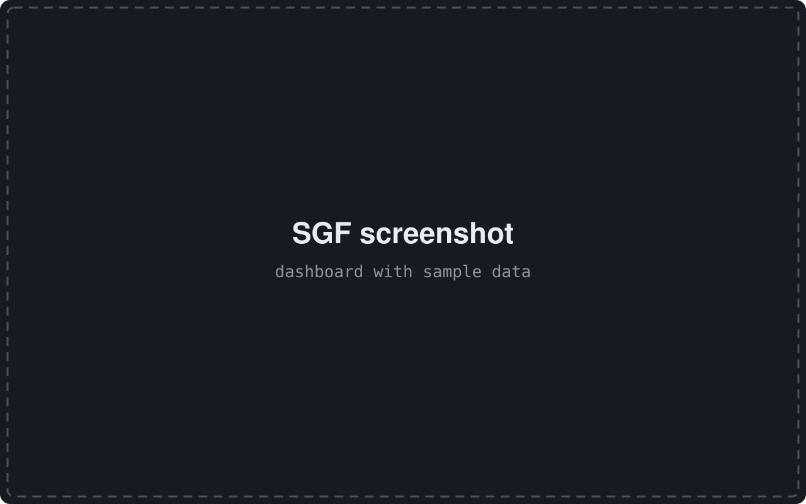
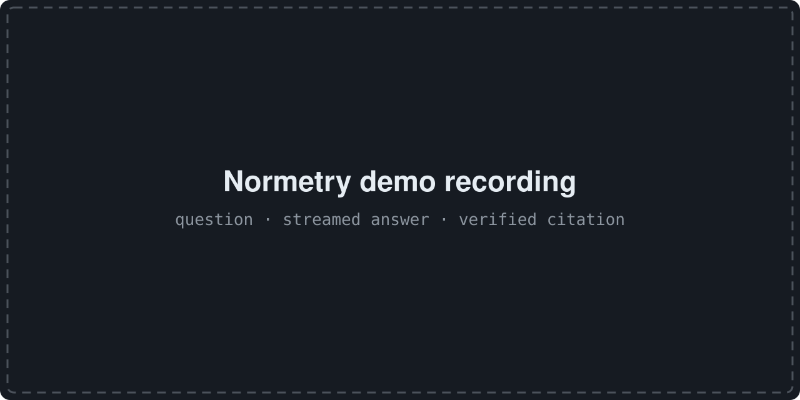

<picture>
  <source media="(prefers-color-scheme: dark)" srcset="profile/banner-dark.svg">
  
</picture>

I build software for fields where a wrong answer costs something: health surveillance, lab research, food-safety compliance and car sales. Four of the products below are in production. Two of them put LLMs to work, and the newest checks every answer against its source.

At my day job at Branef, four years into my career, I build health-surveillance and public-health systems for Brazilian state governments, in C# and .NET on SQL Server.

**[kauacaldeira@hotmail.com](mailto:kauacaldeira@hotmail.com)** · [LinkedIn](https://www.linkedin.com/in/kauavilasboas) · [NuGet](https://www.nuget.org/profiles/kauavilasboas)

 

<picture>
  <source media="(prefers-color-scheme: dark)" srcset="profile/metrics-dark.svg">
  
</picture>

Sources: [NuGet profile](https://www.nuget.org/profiles/kauavilasboas) · [Normetry eval reports](https://github.com/KauaVilasBoas/Normetry/tree/main/evals/reports) · [Normetry ADRs](https://github.com/KauaVilasBoas/Normetry/tree/main/docs/adr) · [Lumen ADRs](https://github.com/KauaVilasBoas/Lumen/tree/main/docs/adr). The card is redrawn every night by [a small workflow](.github/workflows/metrics.yml).

## Running in production

### [Segue o Lead](https://segueolead.com.br) · ● live

An AI sales agent on WhatsApp for car dealerships. It answers every lead from the store's real stock and sends photos of the cars. When a lead is ready to buy, it hands the conversation to the salesperson on shift.

In its first 33 days live it handled 175 conversations and passed 66 qualified leads to sales. 49% of those conversations came in while the store was closed.

`.NET 8` `modular monolith, 10 modules` `transactional outbox` `PostgreSQL RLS` `Claude API` `17 ADRs` · private repository

<!-- TESTIMONIAL: one line from the dealership owner goes here, as a blockquote. -->

 

### [SISLAB](https://github.com/KauaVilasBoas/SISLAB) · ● live demo

Lab management for a pharmacology research lab that used to run on spreadsheets. The dose and dilution math that people worked out by hand now lives in the domain model, configured per lab.

`.NET 8` `modular monolith, 7 bounded contexts` `~1.1k tests` `69 architecture rules` `React`

[Live demo](https://sislab-gamma.vercel.app/login) · [Repository](https://github.com/KauaVilasBoas/SISLAB)

 

### [Lumen](https://github.com/KauaVilasBoas/Lumen) · ● 9k+ downloads

Permission-based authorization and identity for ASP.NET Core. You mark an endpoint with `[RequirePermission]` and mount an admin console at `/lumen`, and the permission catalog and the identity provider stay yours. SISLAB runs on it in production.

`11 NuGet packages` `SQL Server or PostgreSQL` `Redis cache` `7 ADRs`

[NuGet](https://www.nuget.org/packages/Lumen.Authorization) · [Quick start](https://github.com/KauaVilasBoas/Lumen#quick-start)

 

### SGF · Li Joias · ● in production since Dec 2024

Financial management for Li Joias, a jewelry retailer, built at Branef. It covers payables, receivables, installments, cash flow and inventory, and it has run the store's finances for two years.

`Java 17` `Spring Boot 3` `MySQL` `React` `Docker` `GitHub Actions deploys` · private repository

 

## Building now

### [Normetry](https://github.com/KauaVilasBoas/Normetry) · compliance copilot for food service

Normetry reads a restaurant's own SOPs and logs against the food code (FDA Food Code, EU 852/2004, Anvisa RDC 216/2004). For every claim it cites the article, and the passage of the restaurant's document behind it. Before a claim reaches the user, a check confirms that its quote really is in the source, and drops it otherwise.

`.NET 10 core` `Python AI service (FastAPI, LangGraph)` `hybrid search with re-ranking` `PostgreSQL RLS` `1,527 tests` `recall@10 0.934, MRR 0.883` `13 ADRs`

Next: a regulation change monitor, an MCP server and the Azure deploy. [Architecture](https://github.com/KauaVilasBoas/Normetry#architecture-at-a-glance) · [Eval reports](https://github.com/KauaVilasBoas/Normetry/tree/main/evals/reports) · [Roadmap](https://github.com/KauaVilasBoas/Normetry#roadmap)

## Decisions worth reading

Each one is a short document, most of them a five-minute read.

- **Segue o Lead: why a lead waited up to 40 seconds for a reply.** About half of the wait was polling and debounce in the queue, about 9 seconds was the model, and the prompt cache hit rate couldn't be measured yet. *Write-up in progress.*
- **[Spotify Data Analysis: deleting a feature that made the model 0.12% worse](https://github.com/KauaVilasBoas/Spotify-Data-Analysis#what-is-this).** A block of features stays only if it improves the error by 2% on its own, and that rule is code.
- **[Normetry, ADR 013: the simulated inspection checks a fixed checklist of 131 items](https://github.com/KauaVilasBoas/Normetry/blob/main/docs/adr/013-inspection-checks-a-curated-checklist.md).** A fixed list gives precision and recall a fixed denominator, and a run costs one model call per item.
- **[Lumen, ADR-0007: four rules that keep a library generic](https://github.com/KauaVilasBoas/Lumen/blob/main/docs/adr/0007-authz-3.0-generic-library.md).** No seed data, no global enforcement, no Users table and no code written for one consumer.
- **[SISLAB: the active lab lives in a cookie, never in the JWT](https://github.com/KauaVilasBoas/SISLAB#highlights).** Every request checks it against the user's memberships again, and every query filters by it.

## Also built

- **[Spotify Data Analysis](https://github.com/KauaVilasBoas/Spotify-Data-Analysis)**: a data-analysis exercise taken all the way to a system, with idempotent ingestion, a served model and a recommender that explains its picks over 89,740 tracks. Its error is 33.1% below the baseline, and it has 891 tests.
- **PsychoGuard** (private, early): psychosocial-risk management under Brazil's NR-1, with surveys, a risk inventory, action plans and an ethics hotline for each company. .NET 8 and React.

[All repositories](https://github.com/KauaVilasBoas?tab=repositories)

## Stack

**Backend** · C# ● · .NET 8 and 10 ● · ASP.NET Core ● · EF Core ● · Dapper ● · NHibernate ● · Java with Spring Boot ● 
**AI** · Claude API ● · Python · FastAPI · LangGraph · RAG with hybrid search and re-ranking · evals in CI 
**Data** · SQL Server ● · PostgreSQL with RLS ● · pgvector · MySQL ● · Redis 
**Platform** · Docker ● · GitHub Actions ● · Hangfire ● · Keycloak ● · RabbitMQ · OpenTelemetry · .NET Aspire 
**Front end** · React ● · TypeScript ● 
**Practices** · DDD · CQRS · modular monolith · transactional outbox · multi-tenancy · architecture tests · ADRs

● in production. Everything else is used in a public repository above.

---

**Now** (updated <!--updated-->27 Nov 2026<!--/updated-->): shipping phase 3 of Normetry, cutting Segue o Lead's reply time and writing up the 40-second reply. Reach me at [kauacaldeira@hotmail.com](mailto:kauacaldeira@hotmail.com) or on [LinkedIn](https://www.linkedin.com/in/kauavilasboas). [Back to top](#top)
